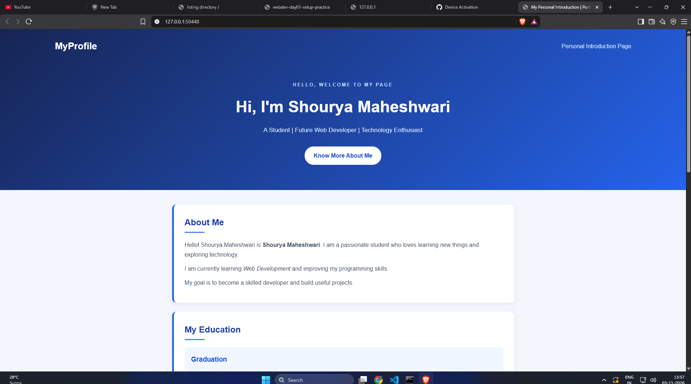

# My Personal Introduction Page

## About Project

This is my Day 02 Web Development assignment.
I have created a personal introduction website
using HTML5 and CSS3.

The website introduces me, my education,
technical skills, interests and future goals.

## Technologies Used

- HTML5
- CSS3
- Visual Studio Code

## Features

- Personal introduction
- Education details
- Technical skills
- Personal interests
- Future goals
- Responsive design
- Semantic HTML structure

## Project Structure

```text
personal-intro-page/
│
├── index.html
├── style.css
├── README.md
└── screenshots/
    └── personal-intro.png
```

## Screenshot



## How To Run

1. Download or clone this repository.
2. Open the project folder in VS Code.
3. Open index.html.
4. Run it in your web browser.

## Learning Outcomes

- Learned basic HTML structure.
- Practiced HTML headings and paragraphs.
- Used semantic HTML elements.
- Learned id, class and data attributes.
- Applied CSS styling and responsive design.

## Author

Shourya Maheshwari


## Website Screenshot


## Assignment

Day 02 - HTML Foundations
